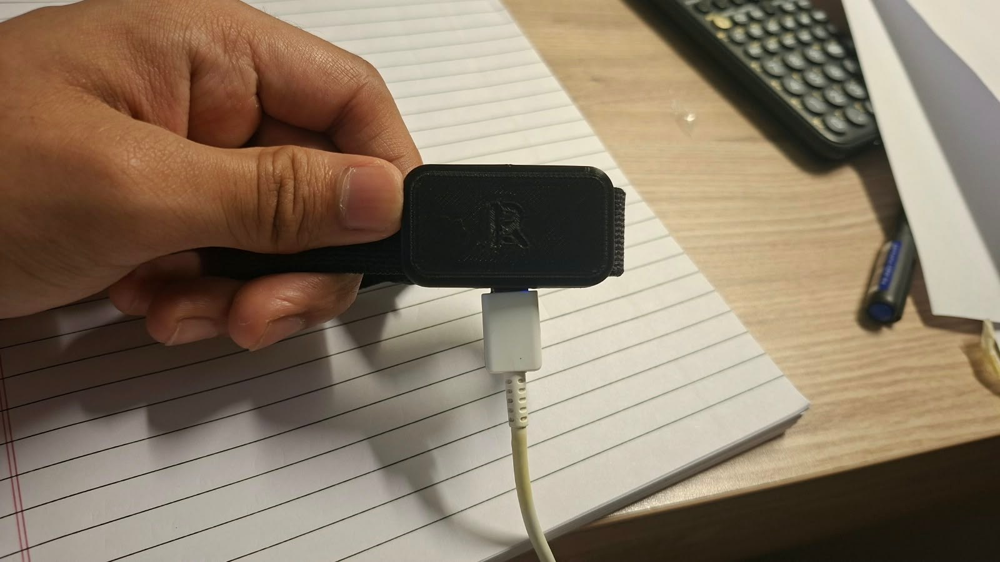
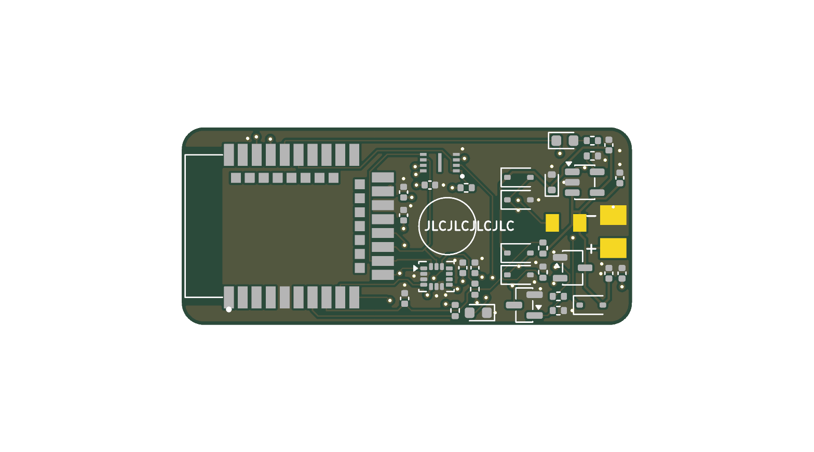

# lift-tracker

**A wrist pod and Android app that count gym reps in real time, measure range of motion per rep, and end the set on their own.**

 

*Left: pod v4 prototype (XIAO nRF52840 Sense + LiPo in a PETG print). Right: pod v2, my own 4-layer board for the Fitbit-sized final pod.*

> Demo clip coming: a set of curls filmed next to a screen recording of the app counting the reps live.

## Results

| | |
|---|---|
| Rep counting | **32 of 33** recorded real sets counted exactly, all 33 within one rep (raw recordings stay private) |
| Kotlin vs reference | the app's Kotlin rep counter is checked against the Python reference (`python/repcount/`) on every push in CI, using simulated sets (`app/android/app/src/test/resources/repsets/`) |
| App | about 16,600 lines of Kotlin + Jetpack Compose, 100 unit tests, screenshot tests in CI |
| Pod v2 | 43.6 × 20.6 × 7.75 mm case, **0.55 mm thinner than a Fitbit Air**, charges on the Fitbit Air charger |

## How it works

```
 pod (nRF52840 + IMU)  ──BLE──►  Android app (Kotlin)
   accel + gyro stream            RepEngine: filter → rep detection → set-end detection
                                  ROM per rep from the gyro, partials flagged under 90%
                                  rest timer, history, progress charts
 python/repcount  ──►  reference counts on simulated sets  ──►  RepEngineTest in CI
```

- **Rep counting:** the app picks the cleanest motion axis for each set and counts reps with hysteresis as you lift. Racking the weight or reaching for the phone is cut from the count, and the set ends on its own.
- **Learns from corrections:** after 3 corrected sets, each exercise gets its own settings.
- **Rep quality:** for rotation lifts (curls, raises, extensions), each rep's range of motion in degrees is compared with your full range from the warm-up set. Reps under 90% are flagged as partials, with speed drop and tempo alongside.
- **Beyond reps:** the app ("Life") also tracks progression with per-lift 1RM estimates, plus recovery, strain and sleep from Fitbit data via Health Connect. How each number is worked out: `docs/HOW_IT_WORKS.md`.
- **Planned:** the same signal chain in Verilog (`rtl/`), tested with cocotb against the Python model.

## Hardware

| | Prototype (pod v4) | Final (pod v2, rev A) |
|---|---|---|
| Board | Seeed XIAO nRF52840 Sense | my own 4-layer, 0.8 mm board, 41 × 18 mm |
| Radio | nRF52840 | nRF52840 module (Ebyte E73) |
| IMU | on-board LSM6DS3 | ST LSM6DSV16X |
| Power | LiPo, USB-C | 40 mAh LiPo, charges on the Fitbit Air charger (no port, no button) |
| Extras | | 2 MB flash, coin vibration motor, updates over Bluetooth |

The pod v2 board is generated from Python (`hardware/pod-v2/pcb/`): schematic, placement, routing and DRC from one script. Fab files, renders and checks are in `hardware/pod-v2/release/liftpod_v2_revA/`.

## Status

- **Working, in daily use:** pod v4 prototype and the app, with live rep counting, ROM per rep, rest timer and history.
- **Ordered:** pod v2 boards, factory-assembled by JLCPCB.
- **Next:** pod v2 bring-up (`firmware/pod/BRINGUP.md`), then the filmed demo and an accuracy write-up.

## Repo layout

```
app/        Android app (Kotlin + Jetpack Compose)
firmware/   Zephyr firmware: logger/ (prototype), pod/ (pod v2)
python/     rep-counting reference model and tools
hardware/   enclosures (OpenSCAD) and the pod v2 KiCad board
rtl/        Verilog + cocotb for the signal pipeline
docs/       logo, photos, how the app computes its numbers
```
