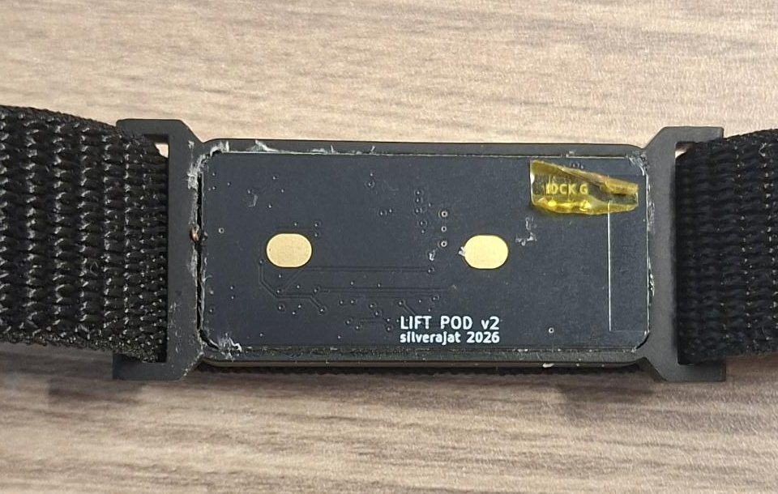
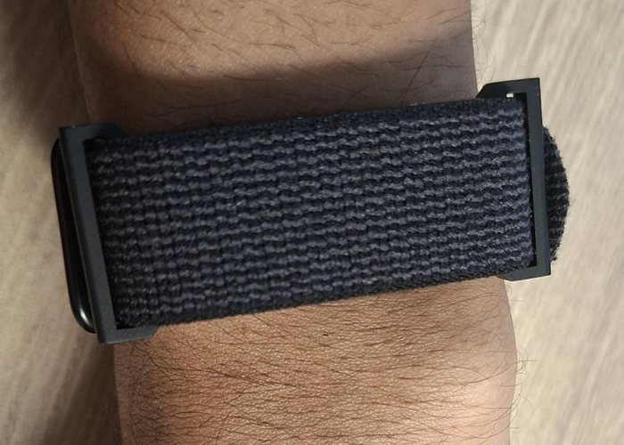
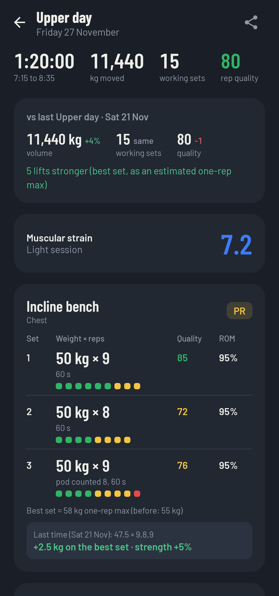
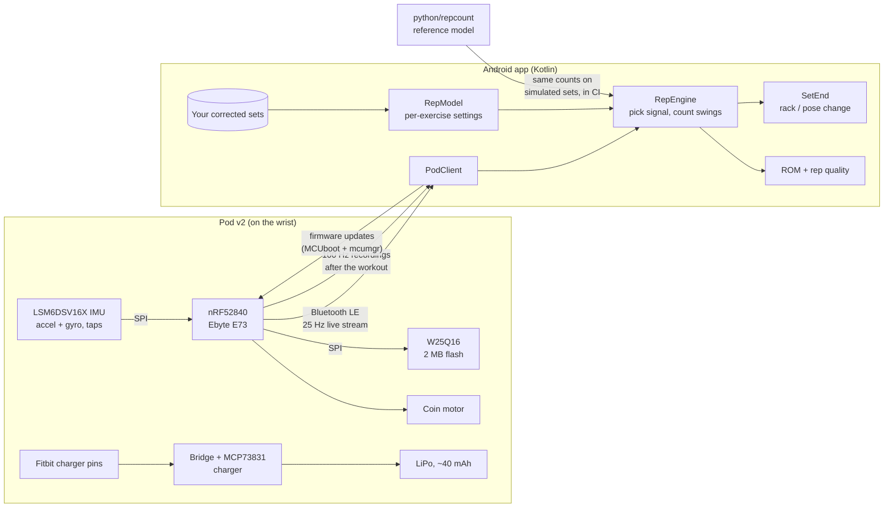
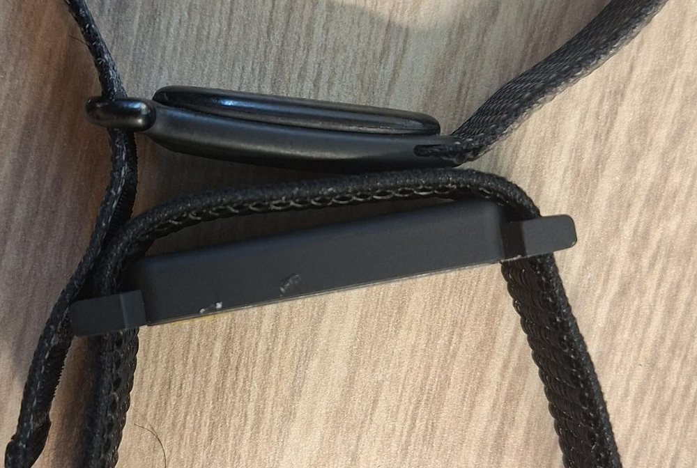
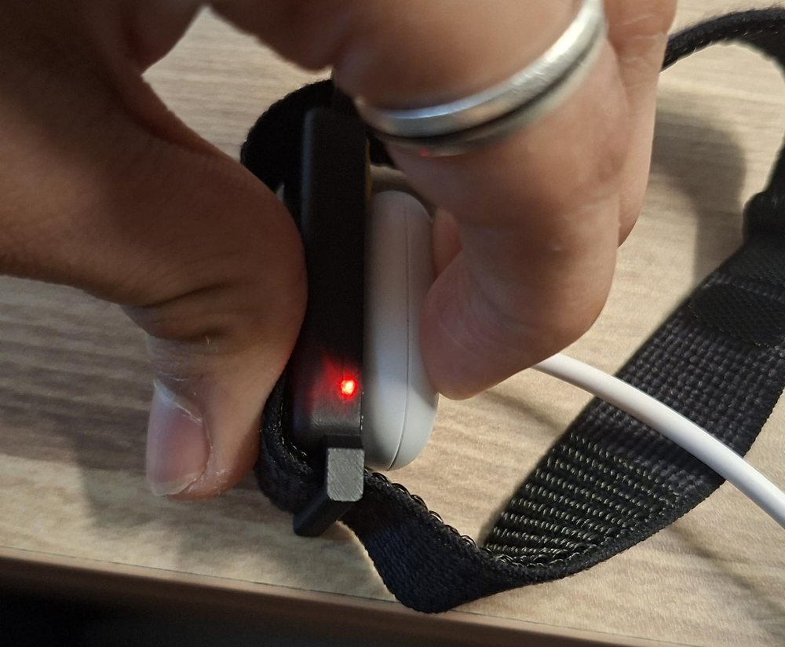
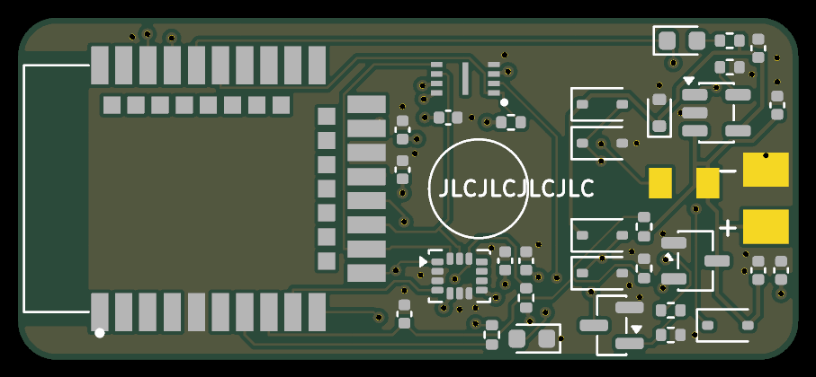
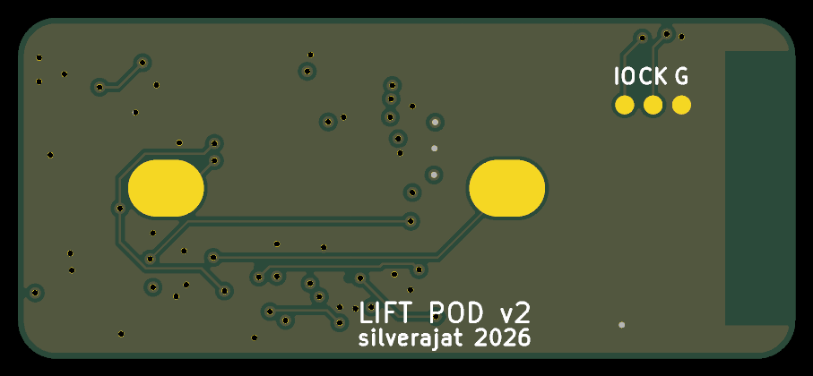
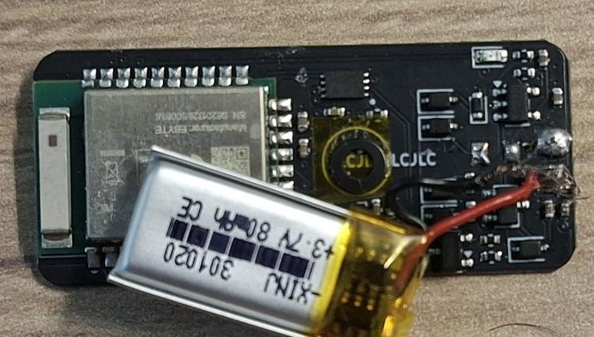

# lift-tracker: a wrist pod that counts your reps

A Fitbit-sized pod I designed and built, plus the Android app it talks to. You wear it on your wrist at the gym
and it counts reps live as you lift, grades each rep's range of motion against your warm-up, ends the set on its
own when you rack the weight (or when you tap it twice), and buzzes when rest is over. Every corrected set
teaches the counter, per exercise.

It spans the whole stack: a 4-layer PCB generated from Python, a printed case, Zephyr firmware with Bluetooth
updates, a rep-counting signal chain checked against a Python reference model, and the app.

**Built with:** KiCad (driven from Python) · Zephyr / nRF Connect SDK (C), MCUboot · Kotlin + Jetpack Compose ·
Python (NumPy) · OpenSCAD · GitHub Actions

> **Demo coming:** a set of preacher curls filmed next to a screen recording of the app counting the reps live.

<p>


</p>

*Pod v2 on its strap. Left: the underside is the board itself: black solder mask, the two gold contacts for the
Fitbit Air charger, and the debug pads under Kapton. Right: worn on the wrist.*

---

## What it does

- **Counts reps live.** The pod streams its accelerometer and gyro to the phone; the app picks the motion that
  repeats most cleanly for that set and counts swings with hysteresis as you lift.
- **Ends the set on its own.** Racking the weight shows up as a last "rep" far bigger than the rest; letting go
  or reaching for the phone puts the wrist at an angle the set never reached. Either one ends the set, cut where
  the change began. Replayed over 88 recorded sets it never cost a rep. Or knock the pod twice to end the set.
- **Grades every rep.** For rotation lifts (curls, raises, extensions) each rep's range of motion is compared with
  your full range from the warm-up. Reps under 90% are flagged as partials, with tempo and speed drop alongside.
- **Learns from corrections.** Every set you correct is a labelled example. After 3 of them an exercise gets its own
  counter settings; warm-ups learn separately because they're lighter and quicker.
- **Knows what it can't count.** Lifts where the wrist barely moves (leg extension, leg curl, reverse crunches)
  aren't counted rather than counted wrong.
- **Keeps the raw data.** The pod records every set at 100 Hz into its own 2 MB flash and the app copies it off
  after the workout. That's what the counter gets retrained on.
- **Has no port and no button.** It charges on the Google Fitbit Air charger, updates its firmware over Bluetooth,
  sleeps unless a workout is open, and restarts itself if the firmware ever hangs.

The app ("Life") also does progression (per-lift one-rep max with a learned reps-per-kilo curve, "next time"
targets), plus recovery, strain, sleep and food from Fitbit data. How every number is worked out:
[`docs/HOW_IT_WORKS.md`](docs/HOW_IT_WORKS.md).



*A finished workout: per set, its quality score, range of motion against the warm-up, and one dot per rep coloured
by that rep's score, so you can see where the set fell apart.*

## How it fits together



| Part | Job |
|---|---|
| **nRF52840** (Ebyte E73 module) | Runs the IMU in low power until you move, records sets to flash, streams live to the phone, ends sets on a double tap, buzzes |
| **LSM6DSV16X** | Accelerometer + gyro; its own tap detector and wake-on-motion so the nRF can sleep |
| **W25Q16** | 2 MB of 100 Hz set recordings (14 bytes a sample), kept until the phone has them |
| **Android app** | Live counting, set end, rep quality, learning, workout log, progression, the rest of "Life" |
| **python/repcount** | The reference rep counter; the Kotlin one has to match it in CI |

## The hardware ([`hardware/pod-v2`](hardware/pod-v2))

- **Target:** the Google Fitbit Air pebble (34.9 × 17 × 8.3 mm), with no port and no button. Result:
  **43.6 × 20.6 × 7.75 mm, 0.55 mm thinner** than the Fitbit and about 9 mm longer (thin over short).
- **The board is the pod's underside.** It sits flush in the rim of a one-piece SLA resin shell; its black mask
  and two gold (ENIG) contacts are the face on your wrist and on the charger. Everything else stacks on top: the
  coin motor on the module, the cell beside it.
- **Charges on the Fitbit Air charger:** contacts 18 mm apart to match its spring pins, a Schottky bridge so the pod
  charges either way round, an MCP73831 at ~21 mA, and a steel washer on top of the board for the charger's magnet.
- **Parts:** Ebyte E73 (nRF52840), ST LSM6DSV16X IMU, W25Q16 2 MB flash, XC6206 LDO (~1 µA), AO3400A motor
  driver, TVS on the exposed contacts, a 301020 LiPo with its own protection (sold as 80 mAh; a cell that
  size really holds about 30–40 mAh).
- **Generated from Python.** [`pcb/design.py`](hardware/pod-v2/pcb/design.py) and
  [`placement.py`](hardware/pod-v2/pcb/placement.py) hold the whole board as data; the scripts beside them write
  the KiCad schematic and layout, route it (staged Freerouting), run ERC and DRC, and export the fab files. ERC
  clean, DRC 0 errors.
- Fab files, BOM, pick-and-place, renders and the schematic PDF:
  [`release/liftpod_v2_revA`](hardware/pod-v2/release/liftpod_v2_revA). Design decisions:
  [`SPEC.md`](hardware/pod-v2/SPEC.md).

<p>


</p>

*Left: the pod (bottom) under a Fitbit Air, edge-on. Right: charging on the Fitbit Air charger; the red LED shows
through a window in the case.*

<p>


</p>

*The board as designed: 41 × 18 mm, 4 layers, 0.8 mm, assembled by JLCPCB.*

## The firmware ([`firmware/pod`](firmware/pod))

- **Zephyr on nRF Connect SDK 3.4**, with MCUboot: the first flash goes over SWD, every update after that over
  Bluetooth from the phone (nRF Device Manager). CI builds both files on every push.
- **Gym mode** only while a workout is open: IMU at 480 Hz with tap detection, sampled at 100 Hz, every 4th sample
  streamed live and every sample written to flash. Otherwise the IMU sits in wake-on-motion at 15 Hz and the nRF
  sleeps.
- **Bluetooth:** a custom service (status, commands, live stream, recording download with resume). The phone
  only connects while you're in the gym part of the app, and the link drops from 7.5 ms to a slow interval
  outside sets.
- **A sealed pod can't be reset by hand,** so a 60 s watchdog restarts it if anything hangs, and the IMU interrupt
  is re-checked every second in case an edge was ever missed.

## The app ([`app/android`](app/android))

- Kotlin + Jetpack Compose, about 18,700 lines, 123 unit tests and screenshot tests, all run in CI; every push
  publishes an installable APK.
- **RepEngine:** builds the candidate signals (gyro turn, tilt from gravity, push), picks the one that repeats most
  cleanly, and counts swings with hysteresis. **SetEnd** watches for racking and pose changes. **RepModel** grid-searches
  the counter's settings per exercise on your corrected sets.
- **The same counter is in Python** ([`python/repcount`](python/repcount)); `RepEngineTest` checks the Kotlin counts
  against it on simulated sets on every push, and `PodV2CountTest` replays real pod v2 sets.

## Bring-up: what broke and how I fixed it

1. **The debug pads were tiny.** I'd sized the SWD pads (1 mm, 1.5 mm apart) for a pogo-pin clip, then soldered wires
   to them by hand. That took two hours. A rev B would get 2.54 mm pads.
2. **The app said "looking for the pod" while the pod was fine.** The boot log cut off mid-line, because the 1 KB log
   buffer filled before the debugger attached. With an 8 KB buffer and a line logged when advertising starts, the log
   showed the pod advertising and something connecting 1.3 s later: the phone, holding a stale link the app didn't
   know about.
3. **A sealed pod went silent, with no way to reset it.** Two fixes: a watchdog so a hang can't brick it, and a
   once-a-second check of the IMU interrupt, because a latched interrupt with a missed edge would stop wake-on-motion
   for good.
4. **The first board killed its own battery.** Every time a cell was soldered on, the pod booted (green blink), then
   the battery read 0.7 V: its protection had cut out. A new cell did the same, as did a board with the motor removed,
   and there was no short across the battery or the motor pads. The likely cause: a loose steel washer I'd been
   trying in different spots on the powered board had bridged pins and damaged a part. The spare board, built with a test after every step, worked
   first time.

   

5. **25% of the battery gone in two hours.** The phone held the pod on a 7.5 ms link all day, and the nRF52 was still
   in debug-interface mode from programming (it only leaves on a full power-off). Now the app connects only in the
   gym and the pod asks for a slow link outside sets.
6. **Moving the counter to the new pod.** The new pod sits differently on the wrist, so I tried retraining the counter
   on pod v2 sets alone. Replayed over the first 21 real sets it missed 103 reps, against 36 with the settings learned
   on the prototype. So the old training stays, and pod v2 sets count 3× as it keeps learning.
7. **The charger's magnet isn't centred between its pins.** With the pins on the pads, the magnet sits off the steel
   washer, so the pod has to be placed carefully. A rev B would move the steel to where the magnet actually is.

Full first-flash and test steps, and the lessons above: [`firmware/pod/BRINGUP.md`](firmware/pod/BRINGUP.md).

## Results

| | |
|---|---|
| Rep counting (prototype pod) | **32 of 33** recorded real sets counted exactly, all 33 within one rep |
| Set end | replayed on 88 recorded sets: no rep ever cut off |
| Pod v2 | built, sealed and in daily use; 0.55 mm thinner than a Fitbit Air; charges on its charger |
| Kotlin vs reference | the app's counter matches the Python reference on simulated sets, checked on every push |

Raw recordings stay private; the simulated sets and a day of pod v2 sets (motion only) are in the test resources.

## Status and next steps

**Working:** pod v2 (board, case, firmware, Bluetooth updates, charging, double tap), the app with live counting,
set end, rep quality, learning, rest timer and history.

**Next:**

- Accuracy table on pod v2 once the counter has learned it (upper-body days first: a wrist pod reads those best)
- Measure battery life over a week (estimated at 5–6 workouts a charge)
- The filmed demo
- Notes for a rev B, if there is one: bigger SWD pads, steel under the charger's magnet
- The rep-counting signal chain in Verilog ([`rtl/`](rtl)), tested with cocotb against the Python model

## Repository layout

```
app/        Android app (Kotlin + Jetpack Compose) and its tests
firmware/   Zephyr firmware: pod/ (pod v2), logger/ (the XIAO prototype)
hardware/   pod-v2/ (board generator, release files, case), earlier prototype cases
python/     repcount/ (reference counter, learning, set end), tools/ (prototype dump and test scripts)
rtl/        Verilog + cocotb for the signal pipeline (started)
tools/      xiao/: double-click scripts for the prototype
docs/       how the app works, logo, photos
```

## Building

**App:** CI builds it on every push (release `app-latest`). Locally, with the Android SDK:
```sh
cd app/android && gradle assembleDebug testDebugUnitTest
```

**Pod firmware** (nRF Connect SDK 3.4.1, Zephyr SDK; ST's `hal_st` as an extra module, see
`.github/workflows/pod-firmware.yml`):
```sh
west build -b liftpod_v2 firmware/pod -- -DBOARD_ROOT=$PWD/firmware/pod -DZEPHYR_EXTRA_MODULES=$NCS/modules/hal/st
```
First flash and updates: [`firmware/pod/BRINGUP.md`](firmware/pod/BRINGUP.md).

**Board** (KiCad 9): fab files, renders and checks from the routed board:
```sh
cd hardware/pod-v2/pcb && ./make_release.sh
```

## Licence

MIT ([LICENSE](LICENSE)).

Rajat Gupta, NUS Electrical Engineering
