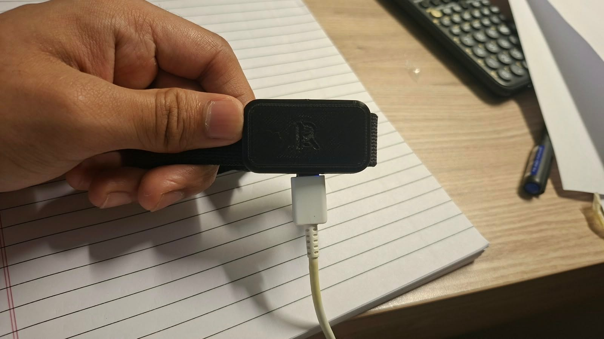

# lift-tracker

A wrist wearable that counts reps, measures rep speed and quality, buzzes when a set has slowed too much or rest is over, and tells me when to add weight. The same signal pipeline is also built in Verilog as an RTL project, verified against a Python golden model on my own gym data.

**Status:** D1 logger running on the XIAO in the printed pod (battery, auto-recording, USB dumps). Now: Bluetooth control from a phone app, so each set is started, stopped and labelled from the phone. Custom PCB v1.1 ready to order.



*Pod v4: XIAO nRF52840 Sense + LiPo in a black PETG print, on a hook-and-loop strap, charging over USB-C through the side hole.*

## Layout

```
firmware/   Zephyr firmware for the XIAO nRF52840 Sense
  logger/     D1: records IMU data to flash, dumps CSV over USB
python/     golden model and analysis of my lift data
  tools/      dump_logs.py: pulls recordings off the board
hardware/   enclosure CAD (OpenSCAD), STLs, later the KiCad PCB
rtl/        Verilog + cocotb tests + formal proofs
app/        the phone app (later, D6)
docs/       logo, accuracy report, photos, demo video
data/       recordings (raw data is git-ignored)
```

## Build order

**Device:** D0 parts → D1 logger → D2 record lifts → D3 Python model → D4 video check → D5 real firmware + Bluetooth → D6 app → D7 buzz alerts → D8 custom PCB → D9 bring-up.

**RTL:** R1 UART + cocotb → R2 full pipeline → R3 formal proofs → R4 FPGA demo.

The full plan lives in my Lift Tracker Wearable doc.
